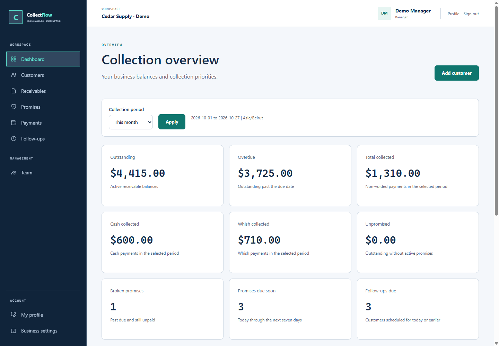
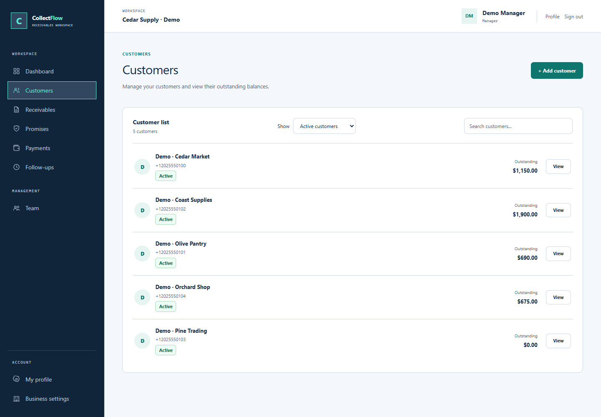
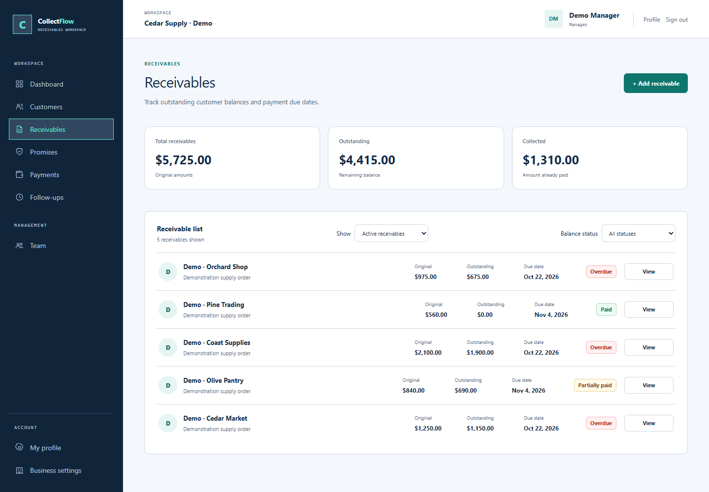
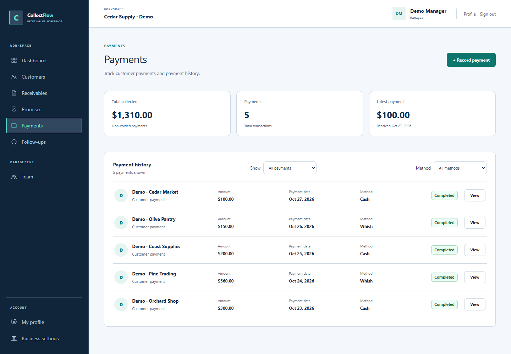
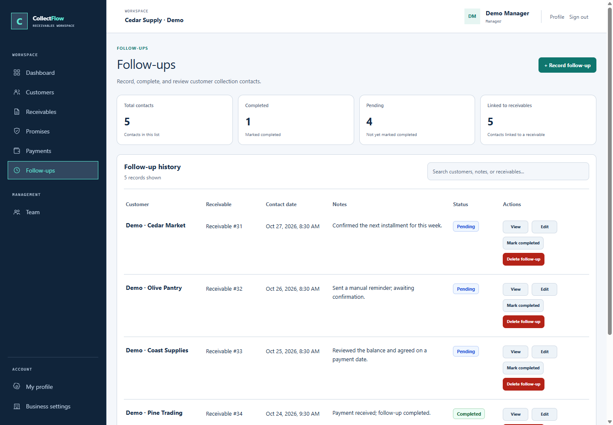
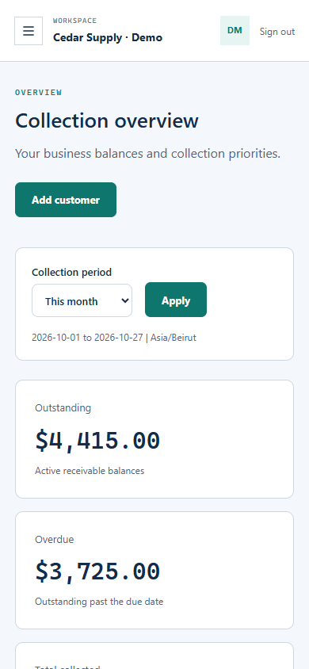

# CollectFlow

This README contains setup, run, validation, and deployment guidance for both the API and frontend.

## About this version

This repository is **Mario El Helou’s customized version** of the [TechTalks CollectFlow team project](https://github.com/fida-jebaoui/techtalks-CollectFlow). The original team’s contributions and responsibilities are credited below.

Mario’s contributions include the collection screens, forms, routes, and responsive frontend design (`8999009`), followed by workflow fixes and a design refresh (`7670a05`). The latter adds a centralized navy/teal palette, accessible dialog and mobile-navigation focus handling, API-backed dashboard metrics and period filters, payment retry protection, stronger financial transaction validation, follow-up completion and retained removal, and regression/browser checks. These changes build on the team’s authentication, backend, and frontend/API integration work; see [the implementation review](docs/project-review.md) for verification scope and remaining limitations.

## Screenshots

Actual captures of the locally running React/Django application, using fictional demonstration data in the [documented disposable browser-review setup](docs/project-review.md#reproduce-the-isolated-browser-review). Names, reserved example phone numbers, notes, and USD amounts are synthetic; no real records were altered or deleted, and no credentials are shown. Desktop captures use a 1440 × 1000 viewport; the mobile dashboard uses a 390 × 844 emulated viewport.

### Dashboard

Collection totals, payment methods, and upcoming collection priorities at a glance.



<details>
<summary><strong>Customers — contact records and outstanding balances</strong></summary>



</details>

<details>
<summary><strong>Receivables — balances, due dates, and payment statuses</strong></summary>



</details>

<details>
<summary><strong>Payments — Cash and Whish history</strong></summary>



</details>

<details>
<summary><strong>Follow-ups — contact notes and completion tracking</strong></summary>



</details>

<details>
<summary><strong>Mobile — dashboard</strong></summary>



</details>

## Project Overview

CollectFlow is a focused receivables-management platform designed for Lebanese small businesses and suppliers.

Many businesses currently manage money owed to them through WhatsApp chats, notebooks, spreadsheets, paper invoices, and memory. This can cause overdue payments to be missed, partial payments to become unclear, and customer promises to be forgotten.

CollectFlow provides one place to manage customers, complete receivable balances, promised installments, actual payments, due dates, and manual WhatsApp follow-ups.

### Target Users

- Lebanese wholesalers and small suppliers
- Cleaning-supply distributors
- Small businesses that sell to customers on credit
- Suppliers who need to track customer payments and outstanding balances

The supplier business uses CollectFlow. Its customers do not need CollectFlow accounts and may have Lebanese or international phone numbers.

### Main Goal

Help suppliers clearly see:

- Who owes money
- The original receivable amount
- How much has been paid and how much remains unpaid
- When receivables and payment promises are due
- Which promises are pending, completed, broken, or cancelled
- Which customers require a WhatsApp follow-up

## Approved MVP

The connected application implements the manual receivables workflow below. See [review results](docs/project-review.md) for tested behavior and remaining limitations.

### Core Features

1. **Business Accounts and Role-Based Access**

   - Register and log in using email and password
   - Support owner and optional staff accounts
   - Allow both roles to perform daily collection work
   - Restrict business settings and staff management to owners
   - Keep every supplier business's data separate

2. **Customer Records**

   - Add and manage customers
   - Require a customer phone number for manual WhatsApp follow-up
   - Default the phone-country selector to Lebanon (`+961`)
   - Allow international customer phone numbers
   - Normalize phone numbers into one international format to prevent duplicates
   - Archive customers without deleting their financial history

3. **Receivable Records**

   - Record the complete amount a customer owes in USD
   - Add an optional reference, description, and issue date
   - Set the receivable due date
   - Calculate the paid and remaining amounts from recorded payments
   - Identify open, partially paid, overdue, and paid receivables

4. **Payment Promises**

   - Divide a receivable into one or more promised installments
   - Allow promises to cover only part of the receivable
   - Show the amount that has not yet been promised
   - Record each promised amount and payment date
   - Identify pending, completed, broken, and cancelled promises
   - Allow one promise to be fulfilled through multiple payments

   Completed is the displayed label for API status `KEPT`; it is reached automatically through non-voided payments. Broken means the promised date has passed with a remaining unpaid amount.

5. **Cash and Whish Payments**

   - Record every payment against a specific payment promise
   - Support cash and Whish as the MVP payment methods
   - Prevent payments from exceeding the promise's remaining amount
   - Recalculate both the promise and receivable balances automatically
   - Void an incorrect payment without deleting its history

6. **Manual WhatsApp Follow-Ups**

   - Open the customer's WhatsApp chat manually
   - Record a note after completing the follow-up
   - Optionally link the follow-up to a receivable or payment promise
   - Store the next follow-up date
   - Mark a follow-up completed independently of its next scheduled date
   - Confirm removal of a follow-up; the record is archived rather than permanently deleted

7. **Mobile-Friendly Dashboard**

   - View total outstanding amounts
   - View overdue balances
   - View collected cash and Whish payments
   - View upcoming and broken payment promises
   - View unpromised receivable balances
   - View customers whose WhatsApp follow-up is due

8. **Financial History and Data Protection**

   - Retain creator and supported archive, cancellation, and void history
   - Allow active payment corrections; payment edits do not currently record an edit actor or timestamp
   - Preserve incorrect payments as voided records instead of deleting them
   - Protect passwords using Django's authentication system
   - Require deployment operators to configure and verify PostgreSQL backups

WhatsApp conversations are opened and handled manually in the MVP.

## Tech Stack

- Frontend: React 19, React Router Data Mode, TypeScript, Vite, and Tailwind CSS
- Backend: Python, Django, and Django REST Framework with session authentication and CSRF protection
- Database: PostgreSQL 17
- Tooling: uv, npm, and optional Docker Compose

## Team & Responsibilities

| Team Member               | GitHub Username | Responsibility          |
| ------------------------- | --------------- | ----------------------- |
| Fida Abbass Jebaoui       |                 |UX/UI +Research&Business |
| Haidar Fadi Jouni         |                 | Database +frontend      |
| Nour Thaer Al Haj Diab    |                 | UX/UI + Frontend Design |
| Zeinab Khalil Hammoud     |                 |    backend 
| Georges Nidal Abou Rjeily |                 | backend                 |
| Mario Georges El Helou    |                 | Frontend                |

## Getting Started

### Prerequisites

- Git, Node.js compatible with the locked Vite version, and npm
- Python compatible with `api/uv.lock` and uv (the API image uses Python 3.13)
- A running PostgreSQL database and matching `POSTGRES_*` environment configuration
- Docker Desktop with Compose if running containerized services

### Installation

From the repository root, install locked dependencies:

```powershell
cd api
uv sync --frozen
cd ../frontend
npm.cmd ci
```

Keep existing `.env` files and database records intact. See [Run this checkout](#run-this-checkout) for database checks and the two development terminals. Registration creates a business and manager account, then sends you to login without starting a session.

## User Journey

The main workflow is:

**Register/Login -> Add Staff if Needed -> Create Customer and Select Phone Country -> Record Receivable -> Record One or More Payment Promises -> View Dashboard -> Open WhatsApp and Follow Up Manually -> Save Follow-up Note -> Record Cash or Whish Payment Against a Promise -> Recalculate Promise and Receivable Balances -> Complete When Fully Paid**

Example:

1. A supplier owner registers and creates a customer with a Lebanese or international phone number.
2. The owner records a `$500` receivable and its due date.
3. The customer promises to pay `$200` on Friday, so the owner records a `$200` payment promise.
4. The dashboard shows `$500` outstanding, `$200` promised, and `$300` unpromised.
5. The owner opens the customer's WhatsApp chat manually and records the follow-up result.
6. The customer pays `$50` in cash and later `$150` through Whish. Both payments are linked to the `$200` promise.
7. The promise becomes Completed automatically, and the receivable remaining balance becomes `$300`.
8. Later promises and payments continue until the receivable remaining balance reaches zero and becomes paid.

## Contribution Workflow

Each team member should work on their assigned task using a separate branch.

### Workflow

1. Create a branch for your task.
2. Make your changes.
3. Commit your work with a meaningful commit message.
4. Push the branch to GitHub.
5. Create a Pull Request.
6. Ask another team member to review the changes.
7. Merge the Pull Request after review.

### Example Branch Names

```text
feature/customer-management
feature/payment-tracking
feature/dashboard
feature/frontend
feature/authentication
```

## Run this checkout

The application is connected end to end. Keep the database configured in the existing `.env` running; do not reset its volume or records. Use two PowerShell terminals:

```powershell
cd C:\Users\user\Desktop\techtalks-CollectFlow\api
.\.venv\Scripts\python.exe manage.py runserver 127.0.0.1:8001
```

```powershell
cd C:\Users\user\Desktop\techtalks-CollectFlow\frontend
$env:API_PROXY_TARGET = 'http://127.0.0.1:8001'
npm.cmd run dev -- --port 5173 --strictPort
```

Open http://localhost:5173. API 8001 avoids an unrelated service already using 8000. Clean-checkout dependency setup: `uv sync --frozen` in `api/`, and `npm.cmd ci` in `frontend/`. Review `manage.py migrate --plan` before applying migrations to a persistent database. Compose also exists for development; its database credentials/ports must match your environment and its API needs reviewed migrations before use.

Before starting Django, run these from `api/`:

```powershell
.\.venv\Scripts\python.exe manage.py check
.\.venv\Scripts\python.exe manage.py migrate --plan
```

Review pending migrations before applying them to persistent records. The additive `payments.0002_paymentrequest` creates a replay table; no authentication history needs resetting.

The frontend is a static SPA, with no SSR server. `npm.cmd` avoids PowerShell restrictions on `npm.ps1`. Alternatively, set `API_PROXY_TARGET=http://127.0.0.1:8001` in ignored `frontend/.env.local` and restart Vite. Vite defaults to API 8000 without an override. Keep browser requests same-origin at `/api/v1/`, preserving sessions and CSRF protection.

An unauthenticated `auth/me/` returns 403 and leads to the public/login flow. A 404 indicates a wrong upstream or route; 502 indicates the upstream cannot serve the request. Check Vite's terminal and the Django listener.

See the [implemented API contract](docs/api-contract.md) and [review results and isolated browser checks](docs/project-review.md).

## Validation

From `api/`:

```powershell
.\.venv\Scripts\python.exe manage.py check
.\.venv\Scripts\python.exe manage.py makemigrations --check --dry-run
.\.venv\Scripts\python.exe manage.py test --settings=config.test_settings
.\.venv\Scripts\python.exe scripts/test_postgres.py
.\.venv\Scripts\python.exe scripts/check_data.py
```

The SQLite suite uses RAM and skips PostgreSQL row-lock tests; the PostgreSQL suite requires CREATEDB permission and creates its own disposable test database. Neither uses existing business records as test fixtures. The integrity script reads normal records and prints counts only. Run Black and `isort --profile black` on changed Python files.

From `frontend/`:

```powershell
npm.cmd test
npm.cmd run typecheck
npm.cmd run build
```

For isolated browser checks, follow [the review setup](docs/project-review.md) before running `npm.cmd run test:browser`. This checks real API workflows with RAM-only test records and saves ignored screenshots in `frontend/test-results/`; it refuses to run without the disposable API marker. There is no lint script.

## UI and workflow conventions

- Shared colors live in `frontend/src/css/palette.css`: navy text/navigation, neutral backgrounds, white surfaces, teal actions, and semantic status colors. Keep status labels and visible focus indicators. Welcome preview amounts are illustrative.
- The dashboard reads nine backend metrics and queues. Period filters apply to collections; outstanding balances and queues are current.
- Promise Completed is API `KEPT`, derived from non-voided payments. Broken means past the agreed date with an unpaid balance. Cancelled and voided records remain in history.
- Payment creation uses a replay key. Active edits may reallocate to eligible promises, with backend validation of both balance chains.
- Follow-ups support optional receivable/promise links, next-date scheduling or explicit clearing, separate completion, and confirmed retained removal. Blank schedule input preserves the current schedule.
- Customer and receivable archive filters expose restoration. Customer details retain financial history and provide manual WhatsApp links.
- Dialogs preserve typing focus, Tab navigation, Escape, and available-trigger focus restoration. Mobile navigation manages focus too. Initial loaders have HydrateFallback; several routes load lazily.

## Deployment configuration

Local development defaults to `DJANGO_DEBUG=true`. For deployment set `DJANGO_DEBUG=false`, a random `DJANGO_SECRET_KEY`, `DJANGO_ALLOWED_HOSTS`, and comma-separated `DJANGO_CSRF_TRUSTED_ORIGINS`. Production enables HTTPS redirects and secure cookies. Configure TLS/proxy trust and validate HSTS before setting `DJANGO_HSTS_SECONDS` (default 0). `DJANGO_TRUSTED_PROXY_COUNT` defaults to 0. Multi-worker auth throttles need a shared Django cache and edge limits. Compose runs a development API server, not a production deployment.

Production TLS, backups, monitoring, and remaining schema constraints require separate deployment review; see [known limitations](docs/project-review.md).
